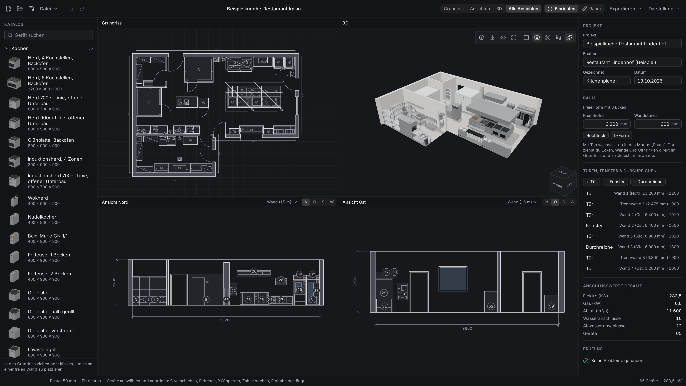
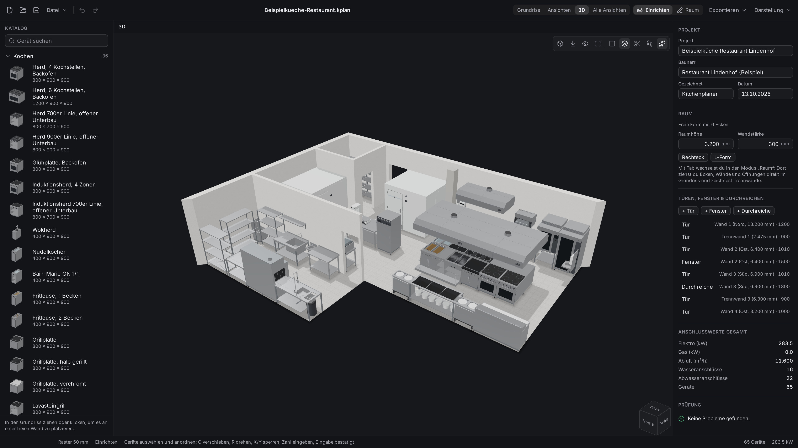
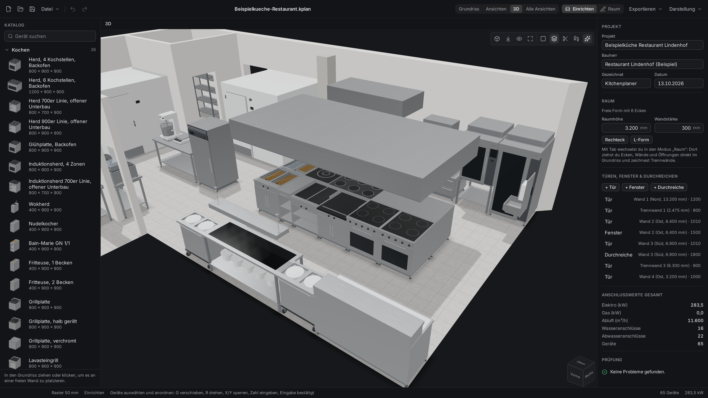
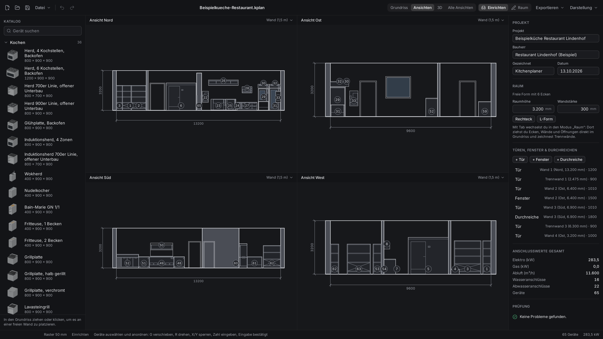

# Kitchenplaner

Kitchenplaner ist eine Desktop-App für die Planung von Profi- und Gastroküchen. Du zeichnest den
Raum, stellst Geräte und Möbel ein und siehst die Küche gleichzeitig im Grundriss, in den Ansichten
und in 3D. Alles läuft lokal auf deinem Computer, ohne Konto und ohne Internet; ein Projekt ist eine
einzelne Datei (`.kplan`). Für Windows, macOS und Linux, auf Deutsch und Englisch.

**[Download](https://github.com/MouseWerk/kitchenplaner/releases/latest)** · [Funktionen](#funktionen) ·
[Installation](#download-und-installation) · [Tastenkürzel](#tastenkürzel) ·
[Entwicklung](#entwicklung) · [English](#english)



## Funktionen

- **Grundriss**: Raum und Geräte maßstäblich in Millimetern, mit Bemaßung, Raster und Einrasten an
  Wänden und Nachbargeräten.
- **4 Ansichten**: die Wände des Raums als bemaßte Ansichten, aus dem Grundriss abgeleitet. Die
  Schnitttiefe wählst du: nur die Wand, der halbe oder der ganze Raum.
- **3D**: die Küche räumlich, in Perspektive oder Parallelprojektion, mit Ansichtswürfel,
  Höhenschnitt und „Begehen“ auf Augenhöhe (W A S D).
- **Katalog mit 165 Geräten** in acht Bereichen: Kochen, Kühlen, Spülen, Tische und Vorbereitung,
  Ausgabe, Lagern, Lüftung und Bauteile (Stützen, Schächte, Bodenabläufe, Rinnen, Podeste), viele
  in mehreren Breiten und als Elektro- oder Gasgerät, jedes mit 3D-Vorschau.
- **Bearbeiten wie in Blender**: Tab wechselt zwischen „Einrichten“ (Geräte anordnen) und „Raum“
  (Ecken, Wände, Trennwände, Öffnungen); G verschiebt, R dreht, X/Y sperren eine Achse, eine
  getippte Zahl gibt das genaue Maß.
- **Raum zeichnen**: „Umriss zeichnen“ Wand für Wand mit getippten Längen und Einrasten auf 90° und
  45°, Trennwände im Raum, Türen, Fenster und Durchreichen.
- **Geräteliste mit Anschlusswerten**: alle Positionen mit Maßen, Elektro, Gas, Wasser, Abwasser
  und Abluft, mit Summen.
- **Prüfung**: Hinweise auf Geräte, die sich überschneiden, aus dem Raum ragen, eine Tür versperren,
  höher als der Raum sind oder in einer Trennwand stehen.
- **Export**: Grundriss als SVG, DXF und PNG, Ansichten als SVG und DXF, 3D-Ansicht als PNG,
  Geräteliste als CSV; das Projekt selbst als `.kplan` (JSON).
- **Helles und dunkles Design**, Deutsch und Englisch, jeweils wie das System oder von Hand gewählt.

| | |
| --- | --- |
|  |  |
| Die Küche in 3D; die Wände zur Kamera blendet die App aus. | Jedes Gerät mit eigenem 3D-Modell. |



*Alle vier Wandansichten, bemaßt, mit allem, was bis 1,5 m vor der Wand steht.* Mehr Bilder mit
Bildunterschriften: [pitch/](pitch/README.md).

## Beispielküche

Zum Ausprobieren gibt es eine fertig geplante Restaurantküche mit 65 Positionen in
[`examples/`](examples/README.md) (Deutsch und Englisch). Die beiden Dateien hängen auch an jedem
Release. In Kitchenplaner „Öffnen…“ (Strg+O) und die Datei wählen, oder die Datei doppelklicken.

## Download und Installation

Die aktuelle Version liegt unter
**[Releases](https://github.com/MouseWerk/kitchenplaner/releases/latest)**. Die Apps sind nicht mit
einem gekauften Zertifikat signiert; Windows und macOS warnen deshalb beim ersten Start.

- **Windows 10/11**: `Kitchenplaner_<version>_x64-setup.exe` starten. Installiert für deinen
  Benutzer, ohne Administratorrechte. Zeigt SmartScreen „Der Computer wurde durch Windows
  geschützt“, auf **Weitere Informationen** und dann **Trotzdem ausführen** klicken. Deinstallieren
  unter Einstellungen → Apps → Installierte Apps.
- **macOS 11 oder neuer** (Apple Silicon und Intel): `Kitchenplaner_<version>_universal.dmg`
  öffnen und Kitchenplaner in „Programme“ ziehen. Die App ist nicht notarisiert: beim ersten Start
  im Finder mit Rechtsklick → **Öffnen** und nochmals **Öffnen** bestätigen; neuere macOS-Versionen
  verlangen stattdessen Systemeinstellungen → Datenschutz & Sicherheit → **Dennoch öffnen**. Meldet
  macOS, die App sei „beschädigt“, im Terminal `xattr -cr /Applications/Kitchenplaner.app`
  ausführen und erneut starten.
- **Linux** (x86-64): `Kitchenplaner_<version>_amd64.deb` für Debian und Ubuntu
  (`sudo apt install ./Kitchenplaner_<version>_amd64.deb`) oder
  `Kitchenplaner_<version>_amd64.AppImage` für andere Distributionen (ausführbar machen mit
  `chmod +x` und starten; das AppImage braucht FUSE 2, unter Ubuntu das Paket `libfuse2` bzw.
  `libfuse2t64`).

`SHA256SUMS.txt` im Release enthält die Prüfsummen aller Dateien. Neue Versionen gibt es auf der
Releases-Seite; die App sucht nicht selbst nach Updates.

## Tastenkürzel

Auf dem Mac steht ⌘ statt Strg.

| Kürzel | Aktion |
|---|---|
| Strg+N, Strg+O, Strg+S | Neues Projekt, Öffnen, Speichern |
| Strg+Umschalt+S | Speichern unter |
| Strg+Z, Strg+Umschalt+Z / Strg+Y | Rückgängig, Wiederholen |
| Tab | Modus wechseln: Einrichten / Raum |
| 1, 2, 3, 4 | Grundriss, Ansichten, 3D, Alle Ansichten |
| F | Ansichten einpassen |
| Mausrad, mittlere oder rechte Maustaste ziehen, Leertaste+Ziehen | Zoomen, Ansicht verschieben |

Im Modus „Einrichten“ (Geräte anordnen, wie Blenders Objektmodus):

| Kürzel | Aktion |
|---|---|
| Klick, Umschalt+Klick oder Strg+Klick | Gerät auswählen, Auswahl umschalten |
| Ziehen auf freier Fläche | Auswahlrahmen: nach rechts nur ganz umschlossene Geräte, nach links alle berührten; Umschalt ergänzt, Strg schaltet um |
| B | Auswahlrahmen aufziehen, auch über Geräten |
| A, Alt+A, Strg+A | Alles auswählen, Auswahl aufheben, Alles auswählen |
| G | Verschieben: folgt der Maus ohne Taste |
| R | Drehen um die Mitte der Auswahl in 15°-Schritten (mit Alt frei); über anderen Ansichten 90° nach rechts, Umschalt+R nach links |
| X, Y während G | Achse sperren (nochmals: frei) |
| Zahl während G oder R | Genauer Wert in mm oder Grad |
| Eingabe, Leertaste oder Klick | Bestätigen |
| Esc oder Rechtsklick | Abbrechen, alles zurück wie vorher |
| Umschalt+D, Strg+D | Duplizieren und verschieben, Duplizieren |
| X, Entf | Auswahl löschen |
| Pfeiltasten (mit Umschalt) | Auswahl um 10 mm (100 mm) verschieben |
| Esc | Auswahl aufheben |
| Alt beim Ziehen oder Verschieben | Ohne Raster und Einrasten |

Beim Ziehen und Verschieben rastet ein Gerät mit der Rückseite an Wänden und Trennwänden ein und
richtet Kanten und Mitten an anderen Geräten aus; Hilfslinien zeigen, woran. Tischgeräte
(Aufschnittmaschine, Waage) stehen auf einem Tisch und rasten nur an einer Wand ein, die sie
berühren; Bodenabläufe und Rinnen liegen im Boden und dürfen unter Geräten liegen.

## Entwicklung

Voraussetzungen: Rust 1.94.1 (wird über `rust-toolchain.toml` gewählt), Node.js 22 oder neuer und
die [Tauri-Voraussetzungen](https://v2.tauri.app/start/prerequisites/) deines Systems (Windows:
Visual Studio Build Tools mit C++ und WebView2; Linux: webkit2gtk 4.1).

```
npm install
npm --prefix ui install
npm run dev      # App mit Vite-Entwicklungsserver (Port 1430)
npm run build    # Installer in target/release/bundle
```

Prüfungen vor einem Commit:

```
cargo fmt --all --check
cargo clippy --workspace --all-targets -- -D warnings
cargo test --workspace
npm --prefix ui run typecheck
npm --prefix ui test
node scripts/version.mjs
node --test "scripts/*.test.mjs"
```

Die Ende-zu-Ende-Tests steuern die echte App: [e2e/README.md](e2e/README.md). Aufbau:
[docs/ARCHITECTURE.md](docs/ARCHITECTURE.md). Ein Release entsteht automatisch, sobald CI auf
`main` grün ist und Release-Notizen für eine neue Version vorliegen:
[docs/release/automatic.md](docs/release/automatic.md).

Fehler und Ideen gern als [Issue](https://github.com/MouseWerk/kitchenplaner/issues);
Sicherheitslücken bitte vertraulich melden, siehe [SECURITY.md](SECURITY.md).

## English

Kitchenplaner is a desktop app for planning commercial kitchens, on Windows, macOS and Linux. It
runs entirely on your computer, without an account; a project is a single `.kplan` file (JSON).

- Floor plan to scale in millimetres, four dimensioned elevations with a selectable cut depth, and a
  3D view with a section height and a walk mode.
- A catalog of 165 units in eight areas (cooking, cooling, washing, tables and preparation, serving,
  storage, ventilation, building elements), many in several widths and as electric or gas units,
  each with a 3D preview.
- Editing in two modes like Blender (Tab: arrange units or edit the room; G moves, R rotates, X/Y
  lock an axis, a typed number gives the exact value), a wall-by-wall room tool, partitions, doors,
  windows and pass-through hatches.
- An equipment list with connection values, a plan check, and exports as SVG, DXF, PNG and CSV.
- German and English, light and dark design. An example restaurant kitchen is in
  [`examples/`](examples/README.md) and attached to every release.

**Download** from the [Releases page](https://github.com/MouseWerk/kitchenplaner/releases/latest):
the Windows installer (`…_x64-setup.exe`, per user, no admin rights), a universal macOS disk image
(`…_universal.dmg`) and Linux packages (`…_amd64.deb`, `…_amd64.AppImage`). The apps are not signed
with a paid certificate: on Windows choose "More info" → "Run anyway" in SmartScreen; on macOS
right-click the app → Open (newer versions: System Settings → Privacy & Security → Open Anyway), or
run `xattr -cr /Applications/Kitchenplaner.app`.

Build it with `npm install`, `npm --prefix ui install` and `npm run dev` (development) or
`npm run build` (installers).

## Lizenz

MIT, siehe [LICENSE](LICENSE).
